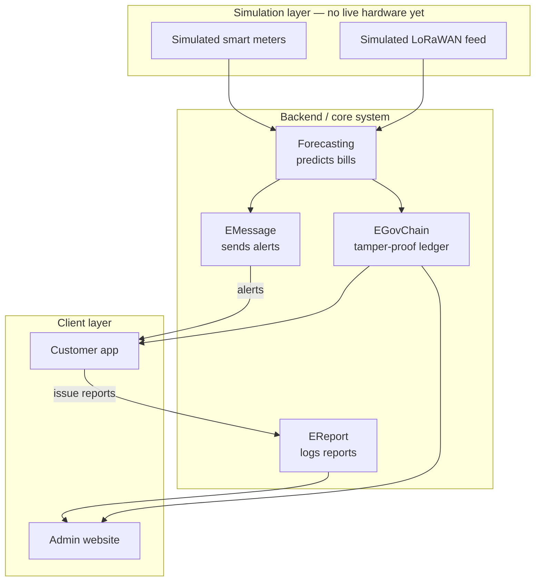

# Meralco Go — System Architecture

Nov 12, 2026 · @Eli

## Overview

This document specifies the system architecture of **Meralco Go**, entered for Hackathon Category 2 (Know Your Bill, Manage Your Usage) and Category 3 (Grid Intelligence from Connected Devices). It covers the system's layers, components, end-to-end data flow, API contracts, and the simulation strategy used to demo it without live LoRaWAN hardware.

Meralco Go replaces deterministic rate-table math with smart-meter/IoT data ingestion and a trained prediction model.

## Architecture overview

Each layer's output feeds the next: simulated readings become a forecast and bill range, and the result reaches staff and customers through the API layer.

## Technology stack

| Layer | Technology | Role |
| --- | --- | --- |
| Simulation | Node.js/Python script (synthetic payload generator) | Generates synthetic smart-meter/LoRaWAN readings and public-data features for the demo |
| Backend API | Next.js API routes or NestJS (Node.js) | Ingestion, forecast orchestration, bill calculation, EMessage/EReport/EGovChain integration |
| Database | PostgreSQL | Readings, forecasts, bills, alerts, reports, ledger records |
| Prediction engine | Python FastAPI (scikit-learn/XGBoost or a lightweight time-series model) | Serves consumption forecast and anomaly score to the backend |
| Bill calculation | Existing JSON rate-config + deterministic engine (reused/adapted) | Converts forecasted kWh into a peso bill range |
| Integration APIs | EMessage, EReport, EGovChain (hackathon-provided, limited credits) | Anomaly alerts, customer reports, immutable ledger |
| Admin website | React or Next.js | Meralco staff interface: monitoring, anomaly review, report triage |
| Customer app | React or Next.js | Customer interface: consumption view, bill breakdown, prediction slider, report form |
| Hosting (demo) | TBD — cloud VM | Hosts backend, database, and prediction engine |

## Simulation layer

No live LoRaWAN hardware exists yet, so a generator script stands in for the smart-meter network.

Two generation modes cover the demo:

1. **Scenario replay** — steady-state consumption profiles (by customer type and time of day) looped on the uplink interval, so the slider and bill view have continuous realistic data.
2. **Injected anomalies** — scripted spikes and tampering-signature payloads fired on demand, so EMessage/EReport can be demonstrated live.

**Payload fields:** meter ID, timestamp, instantaneous kWh, cumulative kWh, signal quality, anomaly-signature flag. **Swap plan:** see "Simulation-to-hardware swap plan" below — the forecasting engine, bill calculation engine, and both client UIs consume the same reading format regardless of source.

## Backend platform

The backend ingests meter/IoT readings (simulated or real), orchestrates the forecasting and bill calculation engines, and brokers the three integration APIs.

- Accepts and validates incoming meter/IoT payloads
- Calls the prediction engine for a forecast and anomaly score per reading
- Runs the bill calculation engine on the forecast
- Triggers EMessage on an anomaly, accepts EReport submissions, writes every prediction to EGovChain
- Serves the admin website and customer app over a REST/JSON API

**Database:** `meters`, `readings`, `forecasts`, `bills`, `alerts`, `reports`, `ledger_entries`, `users`. Target engine: PostgreSQL.

## Prediction engine

A separate service turns readings into a forecast and an anomaly score, so the model can be retrained or swapped without touching the backend.

- Input: meter/IoT reading plus public open-data features (weather/temperature, fuel prices, maintenance schedules, date/seasonality, infrastructure data)
- Output: consumption forecast (kWh) and a per-meter anomaly score
- Served over an internal API the backend calls synchronously

No trained model exists yet for the hackathon demo; a lightweight baseline (a seasonal average or a simple regression) stands in until a model is trained on simulated/historical-style data.

## Admin website

Built for Meralco staff to monitor the system and triage flagged accounts.

- Consumption and anomaly dashboard across simulated meters
- Anomaly review queue, with confidence score and a resolve/escalate action
- EReport triage — incoming customer reports by category
- EGovChain audit view — read-only ledger of what each customer was shown

Authentication: staff login, out of scope for the hackathon demo (mocked).

## Customer app

Built for residential customers to understand their bill before it arrives.

- Consumption and current-bill view
- Prediction slider — drag to a hypothetical usage level, see the predicted bill range update
- "Report a concern" form (EReport) with a category picker
- Alert inbox for EMessage notifications

Designed mobile-first; the hackathon demo runs it as a responsive web app rather than a native build.

## Real-time delivery

End-to-end delivery from an anomaly being flagged to the customer seeing it:

1. A reading arrives at the backend from the simulated feed.
2. The prediction engine returns a forecast and an anomaly score.
3. An anomaly score above threshold triggers EMessage.
4. EMessage delivers a plain-language alert to the customer app.
5. The customer can respond via EReport; the report reaches the admin website's triage queue.
6. EGovChain logs the reading, the forecast, and any alert/report tied to it.

Measured on the simulated feed, not a live LoRaWAN network — real-world latency depends on gateway and API response times once live hardware is in place.

## API integration detail

All three APIs are rate-limited (limited hackathon credits), so each is scoped to one trigger rather than general-purpose messaging.

| API | Direction | Trigger | Payload |
| --- | --- | --- | --- |
| EMessage | Meralco to customer | Forecasting engine flags an anomaly (suspected jumper, consumption spike, tampering signature) | Plain-language alert: what was detected, what happens next |
| EReport | Customer to Meralco | Customer taps "Report a concern" in-app | Structured category (suspected jumper, meter issue, safety hazard, other) + optional note/photo |
| EGovChain | Both sides, append-only | Every billing cycle / every prediction shown to a customer | Consumption reading + predicted figures, written as an immutable record |

EMessage and EReport are the two directions of the same conversation; EGovChain sits underneath both as the record of truth.

## Simulation-to-hardware swap plan

No live LoRaWAN hardware or real Meralco meter feed is available for the hackathon, so the simulation layer stands in for both.

Synthetic meter/IoT payloads and injected anomaly events are generated and replayed through the real forecasting engine and the real bill calculation engine, driving the actual app UI end to end: the slider, the bill prediction, and the EMessage/EReport/EGovChain flows all run on genuine logic against representative, not live, data.

Swapping the simulation layer for real hardware later requires no change downstream: the forecasting engine, bill calculation engine, APIs, and both client UIs consume the same reading format regardless of whether it came from a simulator or a physical meter.

## Development roadmap

1. **Hackathon (now):** blueprint + simulated demo — synthetic readings driving the real prediction and bill-calculation logic through the real app UI.
2. **Pilot:** validate the prediction model against a small batch of real LoRaWAN-enabled meters.
3. **API integration:** connect live EMessage/EReport/EGovChain endpoints once access is confirmed beyond the hackathon credit limit.
4. **Scale:** extend anomaly detection and the admin dashboard for territory-scale grid-ops use.

Status: simulated demo built for the hackathon; live hardware pilot and a trained model are the next steps.

## Assumptions and limitations

- **Simulated, not live, data.** The demo runs on synthetic meter/IoT payloads and sample public-data features, not real LoRaWAN hardware or Meralco meter feeds.
- **Prediction is a range, not a guarantee.** The bill prediction slider shows a low/base/high range, since consumption forecasting is inherently uncertain.
- **Anomaly detection carries false-positive risk.** A "suspected jumper" flag is shown as a confidence-scored signal for review, not an accusation.
- **No official Meralco API.** EMessage/EReport/EGovChain access is based on limited hackathon credits; a production version would need confirmed API terms.
- **Existing rate-calculation limitations still apply** to the bill-calculation layer: standard residential accounts only, no solar net-metering or special rate schedules.
- **What this is not:** not a replacement for Meralco's official billing systems or customer service, not a dispute-resolution or payment tool, and not a surveillance system — EReport submissions are customer-initiated, not automated monitoring of individuals.
